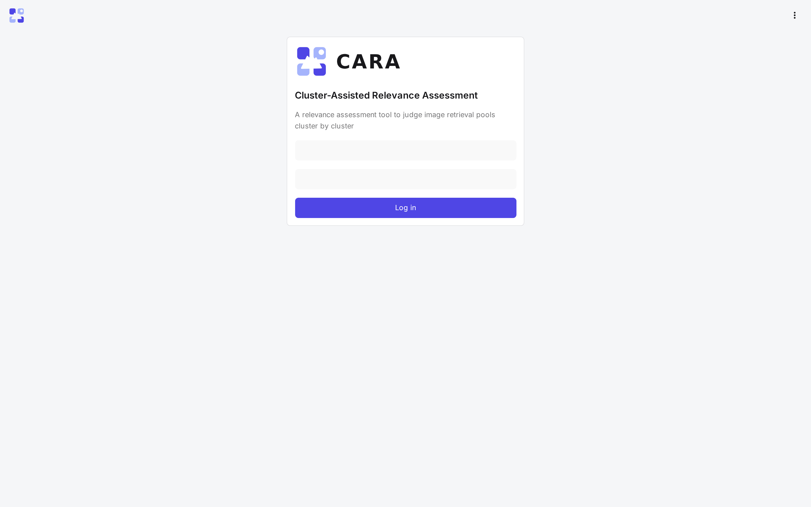
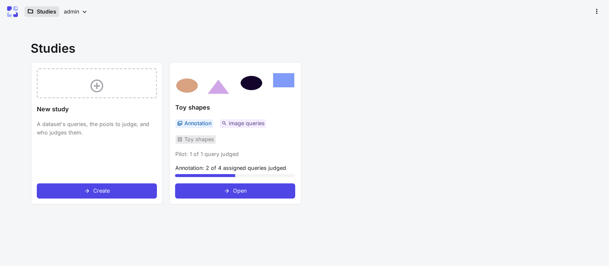
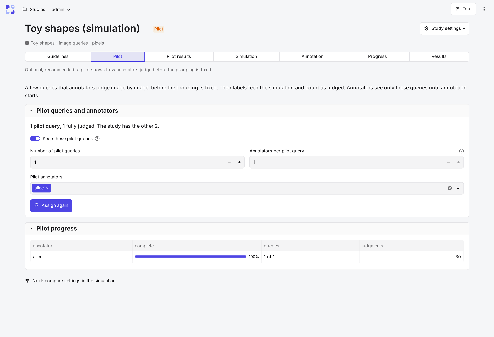
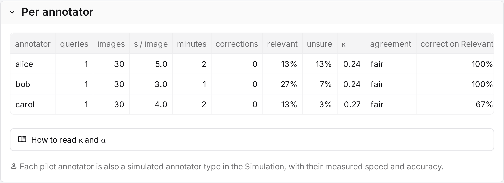
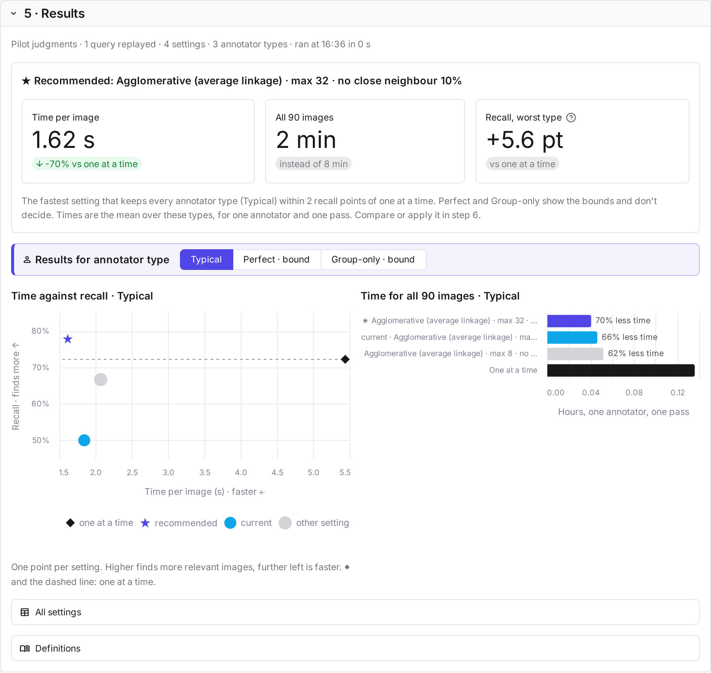
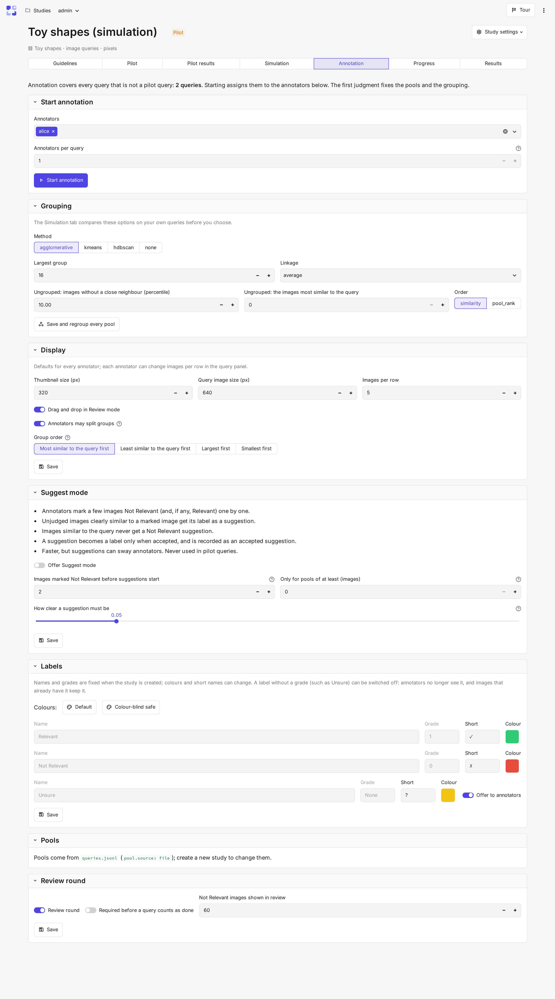
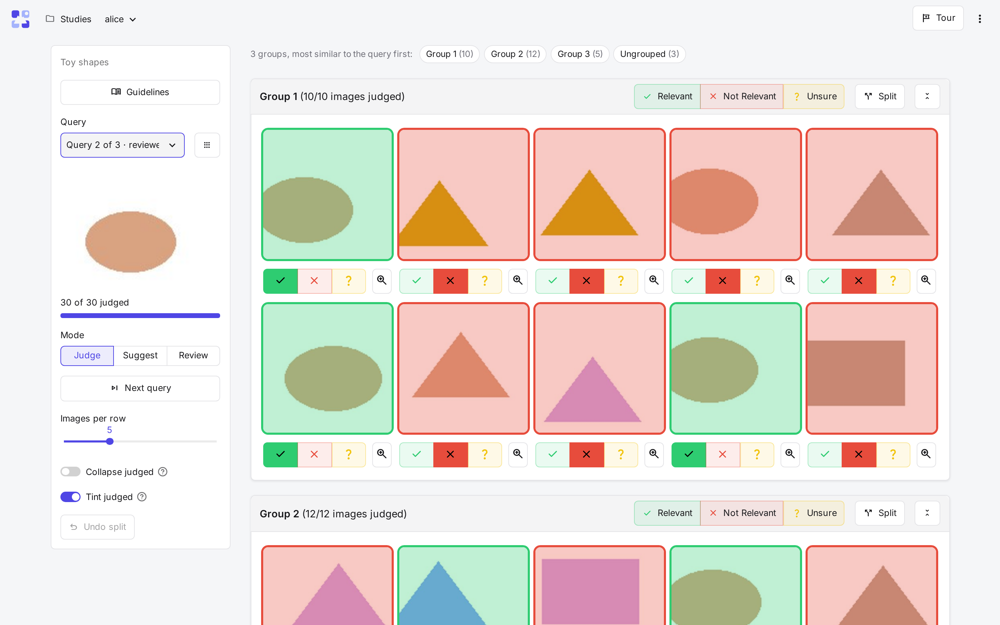
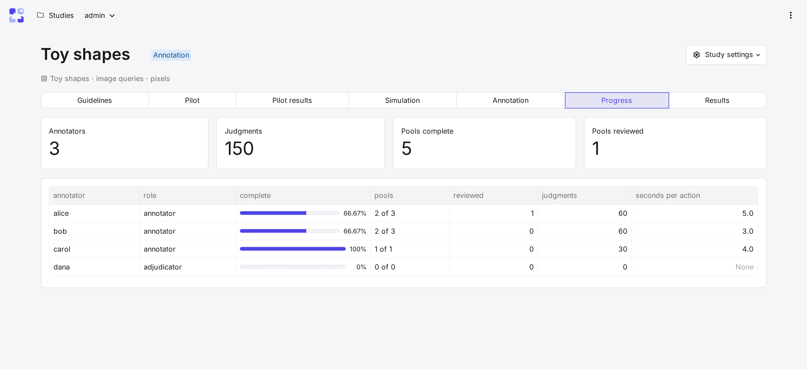

# Tutorial: a first study

This tutorial takes one study from start to finish on the toy dataset: three queries of coloured shapes, each with a
pool of 30 images, small enough to finish in about ten minutes. You switch between two accounts: `admin`, who runs
the study, and `alice`, who judges it.

!!! info "Before you begin"
    CARA runs with the toy data: `bash quickstart.sh --toy` ([Installation](installation.md)). Use a private
    browser window for one of the two accounts, so both stay logged in.

## 1. Log in

Open <http://localhost:8501> and log in as `admin`, with the password `quickstart.sh` wrote to `.env`
(`CARA_ADMIN_PASSWORD`).

## 2. Open the study

The **Studies** page shows one card per study, with its stage and progress. The toy study is already created: its pools are given
candidates, and its grouping encoder is `pixels`. **Open** on the *Toy shapes* card shows the study's tabs, in the order of the work: **Guidelines**, **Pilot**, **Pilot results**, **Simulation**,
**Annotation**, **Progress** and **Results**.

## 3. Write the guidelines

**Guidelines** holds what counts as relevant. Write one sentence in **Text**, such as "Relevant: the same shape in
the same colour as the query", and save it. After a pilot, you can add examples from the images annotators disagreed
on ([Guidelines](../study/guidelines.md)).

## 4. Run a pilot

A pilot is a few queries that annotators judge one image at a time, before the grouping is fixed. It shows how
they judge, and its labels let the simulator compare grouping settings on your own data.

In **Pilot**, under *Pilot queries and annotators*, set **Number of pilot queries** to 1, keep `alice`, and select
**Start the pilot**.

Now, as `alice`, select **Judge** on the study's card. Label each of the 30 images with the buttons under it:
Relevant, Not Relevant or Unsure.

## 5. Read the pilot results

Back as `admin`, **Pilot results** shows how fast `alice` judged and how often they chose Relevant or Unsure. With
two or more pilot annotators it also shows how much they agree.

## 6. Compare grouping settings

**Simulation** replays the study's queries under the grouping settings you choose, with simulated annotators. It
shows what each setting costs in time and how many relevant images it misses. Use alice's pilot labels as the
ground truth, keep the default annotator types and methods, and select **Run the simulation**.

CARA recommends a setting, but the choice stays yours. **Use this setting** proposes the one you pick on the
**Annotation** tab.

## 7. Start annotation

If you chose a setting, select **Save and regroup every pool** on the **Grouping** card of the **Annotation** tab.
Until you save it, the study keeps its current grouping. Then select **Start annotation**, which assigns the remaining
queries to the annotators.

!!! warning
    The first judgment of an annotation query locks the settings that would change what was judged: the pools,
    the grouping and the review rules.

## 8. Judge

As `alice`, the judge page opens on the first unfinished query: the query on the left, its pool on the right, in
groups of similar images.

- The bar on a group labels every image in it; the buttons under an image label just that one.
- **Split** divides a mixed group in two.
- Once every image has a label, **Review** shows them sorted by label, to check and correct.
- **Next query** moves on.

Every click is saved at once. The **Tour** button at the top right explains the page step by step.

## 9. Follow progress and export

As `admin`, **Progress** shows each annotator's queries, judgments and time. **Results** shows the agreement,
sets the final labels where annotators disagree, and exports the qrels, training pairs and action log.

## What you did

You ran the whole workflow: guidelines, a pilot, a simulation to choose the grouping, annotation and export. To
judge your own collection, start with [Datasets](../setup/datasets.md).
