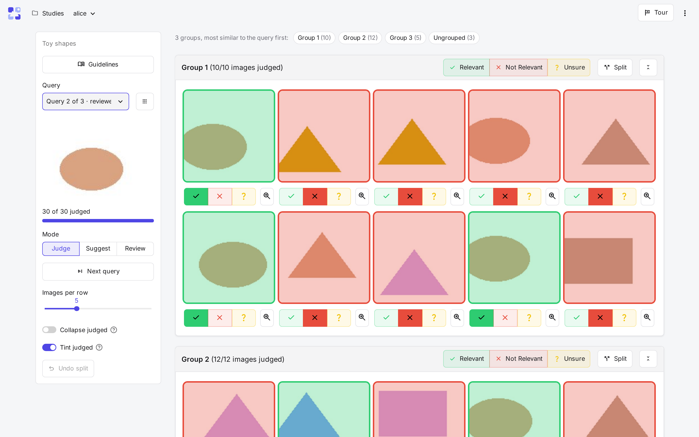

# CARA

**Cluster-Assisted Relevance Assessment for image retrieval.** CARA is a web tool for judging every image in the
pool retrieved for a query, so that each one ends up with a relevance label. It groups the pool's images by visual
similarity: an annotator labels a whole group with one click and corrects single images where needed. Queries can
be an image, a text, or both (composed retrieval), and the output is TREC qrels.

## Features

- **Group, then correct.** Groups of similar images, most similar to the query first. A mixed group splits in
  two, and a group label never overwrites an image labelled on its own.
- **Candidate sampling.** The candidates of existing runs, the nearest neighbours of one or more encoders (TREC-style
  depth pooling), or a random sample as a baseline.
- **Pilot, simulate, then annotate.** A pilot shows how people judge. The settings simulator then replays your
  queries under each grouping and shows what it costs in time and recall.
- **Guidelines with real examples.** What counts as relevant, illustrated with the images pilot annotators
  disagreed on.
- **Several annotators.** Fair, shuffled queues, progress per person, Cohen's κ and Krippendorff's α, and
  adjudicators for the final labels.
- **Exports.** TREC qrels per annotator and by consensus, training pairs with hard negatives, and the full action
  log for effort studies.

## Where to start

| You want to | Read |
|---|---|
| try CARA on your machine | [Installation](get-started/installation.md), then the [tutorial](get-started/tutorial.md) |
| try it on museum images | [A study on The Met](get-started/installation.md#a-study-on-the-met) |
| judge your own collection | [Datasets](setup/datasets.md), then [Run a study](study/index.md#from-a-dataset-to-pools) |
| host it for a team | [Deployment](setup/deployment.md) |
| judge images in a study you were added to | [Judging](judging/judging.md) |
| add an encoder or a grouping method | [Extending CARA](reference/extending.md) |
| reproduce the paper | [Reproducing the paper](reproducing.md) |

## Citation and licence

CARA is released under the [MIT licence](https://github.com/TIBHannover/CARA/blob/main/LICENSE). To cite it, use the
[citation file](https://github.com/TIBHannover/CARA/blob/main/CITATION.cff), which GitHub shows as **Cite this repository**.
Each release is archived on [Zenodo](https://doi.org/10.5281/zenodo.23866166).
