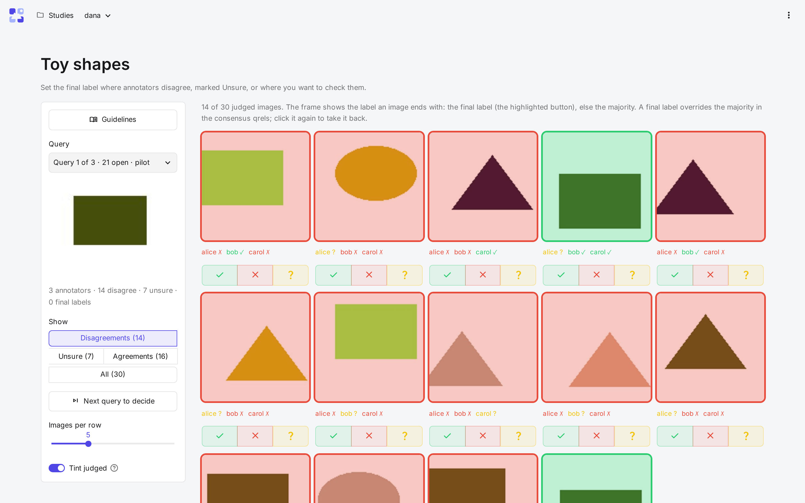

# Adjudicating

This page is for adjudicators, and for admins who settle disagreements in the **Results** tab. Where annotators
disagree or chose Unsure, you set the **final label**, which overrides the majority in the study's consensus qrels.
**Adjudicate** on your study card opens the page.

The page is laid out like the [judge page](judging.md): a query on the left, its judged images on the right,
each framed in the colour of the label it ends with (the final label, else the majority).

| Control | What it does |
|---|---|
| **Show** *default: Disagreements* | Filters the images: *Disagreements*, *Unsure*, *Agreements* or *All*. |
| Annotators' labels | Under each image, every annotator's label. |
| Label buttons | Set the final label; a second click takes it back. |
| **Next query to decide** | Jumps to the next query with disputed or Unsure images left. |

A tie between annotators stays undecided, and its query is left out of the consensus qrels until you set the
final label. The [guidelines](../study/guidelines.md) open from the top of the query panel, as for annotators.
