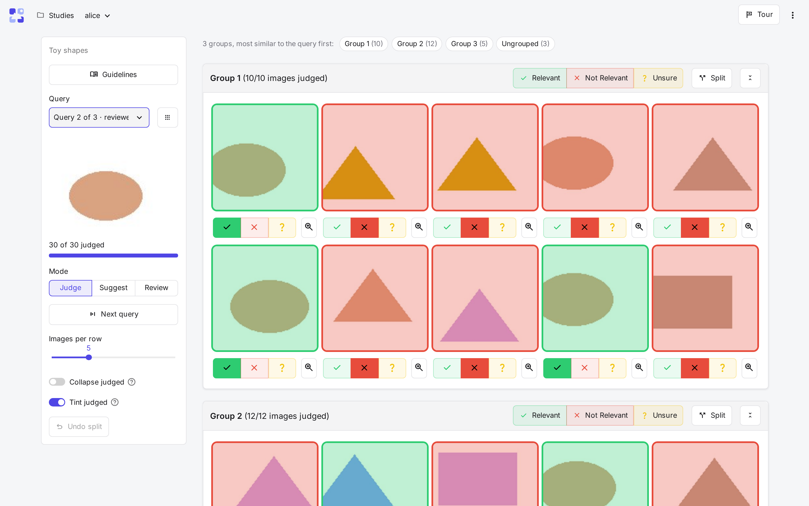
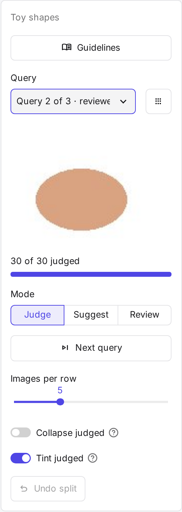
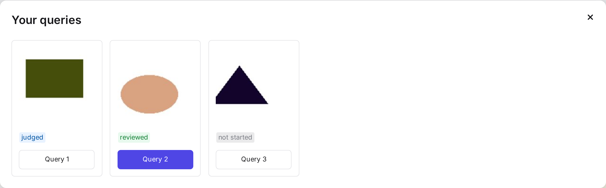
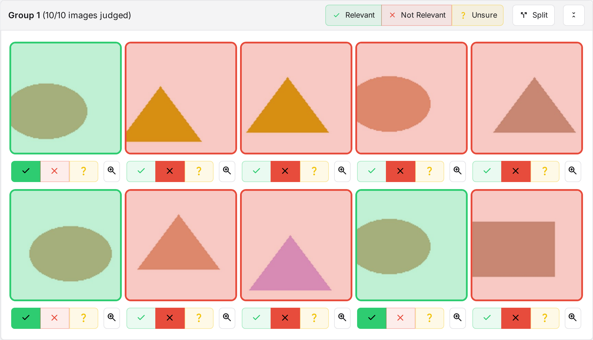
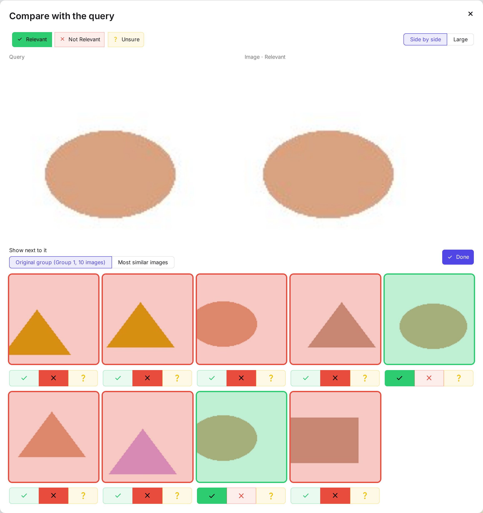
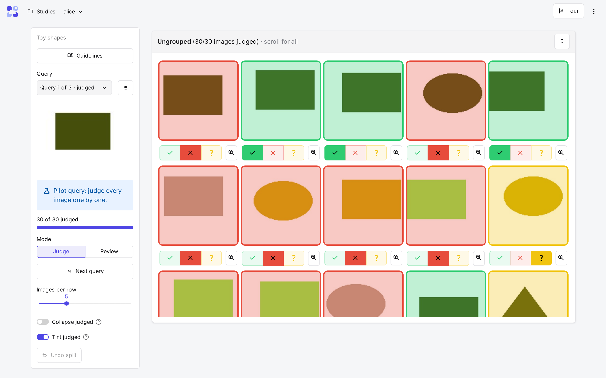
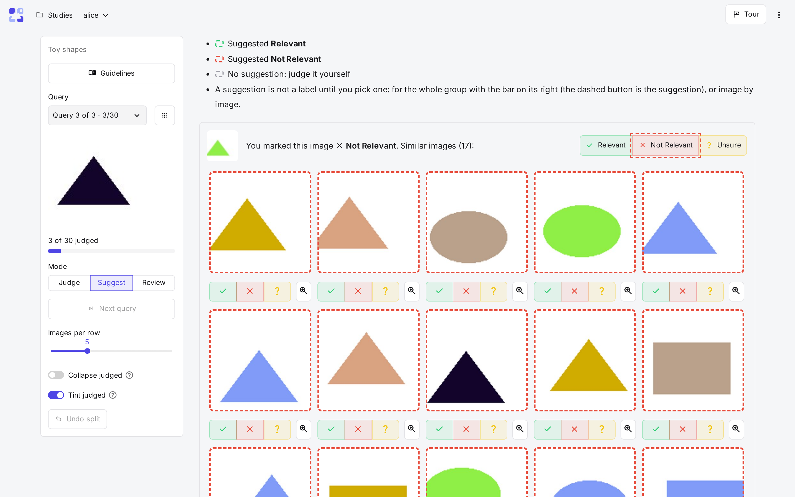
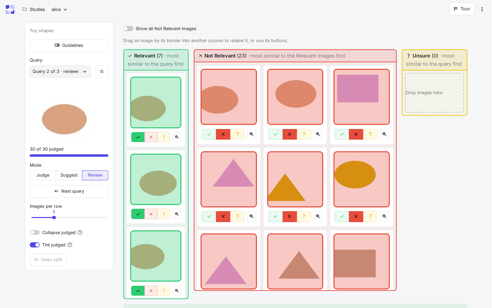

# Judging

This page is for annotators. **Judge** on your study card opens the judge page on your first unfinished query. Every click is
saved at once, and logging in again brings back your labels, splits and review state as you left them. The
**Tour** button at the top right walks through the page you are on.

## The query panel (left)

- **Guidelines** at the top opens the study's [annotation guidelines](../study/guidelines.md), with examples, if the admin
  wrote any.
- **Query**: the picker lists your queries with how far you got (*not started*, *3/50*, *judged*,
  *reviewed*); pilot queries come first and are marked. The grid button next to it shows them all as cards.
- The query itself (an image, a text, or both) and a bar with how many of its images are judged.
- **Mode**: *Judge*, *Suggest* (when the admin offers it) and *Review* (when the study has a review round).
- **Next query** opens your next unfinished query.
- **Images per row** makes the images bigger or smaller; it is your own setting.
- **Collapse judged** folds every group whose images all have a label; switch it off to unfold them.
- **Tint judged** lays a tint in its label's colour over each judged image; switch it off to see the images plain.
- **Undo split** merges back the last group you split.

{ width="260" }

## Judge mode

The pool is shown as **groups of similar images**, then the **Ungrouped** images, judged on their own (those
unlike any other, and, if the admin set it, those most similar to the query).

- The links above the groups jump to any group and say how many images each holds and how the groups are
  ordered (most similar to the query first, unless the admin chose otherwise).
- **The bar on a group** (Relevant, Not Relevant, Unsure) labels every image in it with one click.
- **Clicking the label again**, on a group's bar or under an image, takes it back.
- **The buttons under an image** label just that image. A group click never overwrites an image you labelled on
  its own; the group then says so and offers to set those images too.
- **Split** divides a mixed group in two by similarity; each half gets its own bar. Only you see your splits.
- **The zoom button** under an image compares it with the query side by side, and shows it among its group or
  the pool images most like it, where you can label them too. **Done** redraws the page with what you changed.
- A judged image gets a frame and a tint in its label's colour. A large group scrolls inside its box.

{ width="600" }

**Pilot queries** are not grouped: every image is judged on its own. Their labels show how well grouping would
work for the rest of the study, so take your time.

## Suggest mode

Suggest mode proposes labels for images you haven't judged yet.

1. In Judge mode, mark a few images **Not Relevant** one by one. The study sets how many.
2. Switch to **Suggest**. An unjudged image gets a suggestion when it is clearly closer to an image you marked than
   to images of the other label. Its frame shows the suggested label, and a grey frame means no suggestion.
3. Pick a label, for a whole group with the bar on its right, or image by image. In the bar, the dashed button is
   the suggestion. A suggestion is not a label until you pick one.

Your corrections become new starting points for further suggestions.

## Review mode

Once every image of the query has a label, Review shows one column per label:

- Relevant and Unsure start with the images most similar to the query.
- Not Relevant starts with the images most similar to those you judged Relevant, where a missed Relevant image
  is most likely. It shows the first 60 (the study's setting); **Show all** shows the rest.
- **Drag an image** by its border into another column to relabel it, or use its buttons.
- **Done reviewing** marks the query as reviewed. If the study requires review, a query counts as done only
  then.

When your last query is done, a dialog says so. You can come back at any time to change a label.

## Studies without an encoder

An admin can create a study that judges every image on its own, without embeddings. Its queries have no groups,
so there is no split, no Suggest mode and no "most similar" view; images keep their pool order, also in Review.
