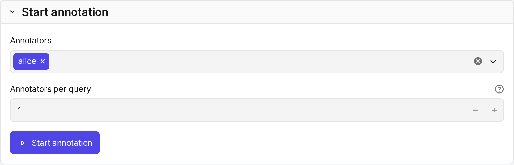
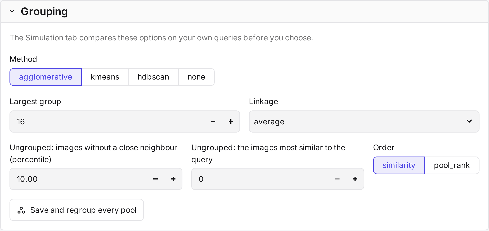
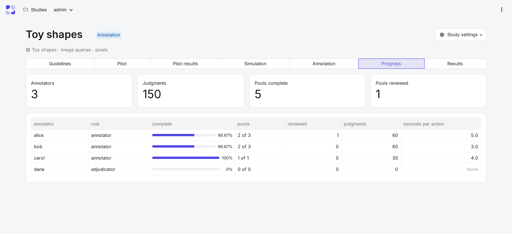

# Annotation

The **Annotation** tab starts the main round of judging. It assigns every query that is not a pilot query, and it
holds the study's settings. The **Progress** tab then shows how far each annotator is.

!!! info "Before you begin"
    The study has annotators. A setting chosen in the [simulation](simulation.md) waits on the **Grouping** card:
    select **Save and regroup every pool** to apply it, before annotation starts.

## Start annotation

| Field | What it does |
|---|---|
| **Annotators** *default: all* | Who judges the annotation queries. |
| **Annotators per query** *default: 1* | How many annotators judge each query. Two or more give agreement and consensus labels. |
| **Start annotation** | Assigns the queries to the annotators in turn. Later, **Assign again** moves queries between annotators. Judgments stay with the person who made them. |

Each annotator gets their queries in a random order of their own, after their pilot queries.

## Settings

Below **Start annotation**, one card per group of settings. [Study settings](../reference/settings.md) describes
each setting and its default.

| Card | Sets |
|---|---|
| **Grouping** | The grouping method, which images stay ungrouped, and the order within groups. |
| **Display** | Image sizes, images per row, drag and drop, splitting, and the group order. |
| **Suggest mode** | Whether it is offered, and how many marked images it needs. |
| **Labels** | Colours, short names, icons, and whether Unsure is offered. |
| **Candidate sampling** | The pooling encoders and their depths, or the random draw. **Save and rebuild pools** samples the pools again. |
| **Review round** | Whether there is a review round, whether it is required, and how many Not Relevant images it shows. |

!!! warning "The first judgment locks the study"
    The first judgment of an annotation query fixes the pools, the grouping and the review rules. This keeps all
    judgments comparable. The name, query order, display, Suggest mode, guidelines, label colours and annotators
    per query can still change. Pilot judgments lock nothing.

## How a pool is grouped

CARA groups a pool in four steps. It does this when the study is created and whenever the grouping changes.

1. **Set aside the ungrouped images.** Images without a close neighbour in the pool stay ungrouped. Optionally, so
   do the images most similar to the query.
2. **Partition the rest** with the grouping method: agglomerative clustering, k-means or HDBSCAN.
3. **Cap the group size.** A group above the maximum size is split in two until it fits.
4. **Order by similarity to the query:** the images within each group, and the groups by their mean similarity.

Annotators can split a mixed group in two the same way, and undo the split.

## Progress

The **Progress** tab shows the study's totals and one row per member.

| Column | Shows |
|---|---|
| **complete**, **pools** | Share and number of assigned pools with every image labelled. |
| **reviewed** | Pools marked as reviewed. |
| **judgments** | Images labelled. |
| **seconds per action** | Median time between actions, without pauses over 10 minutes. |
