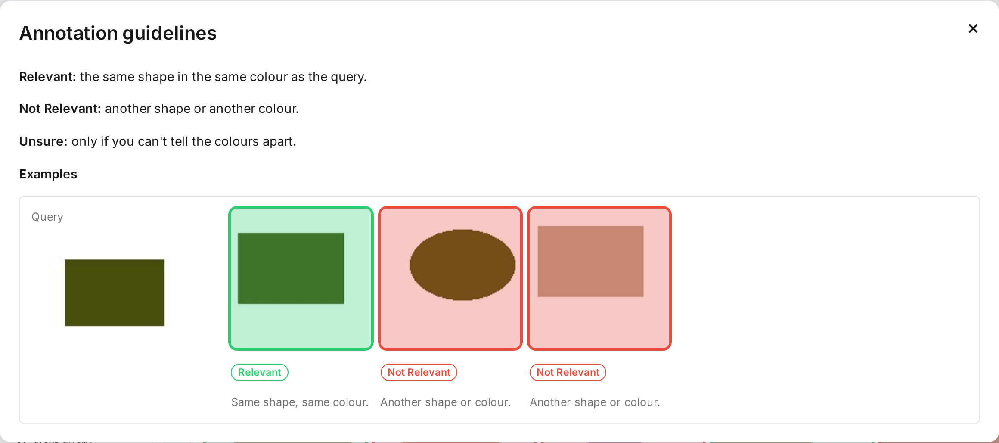
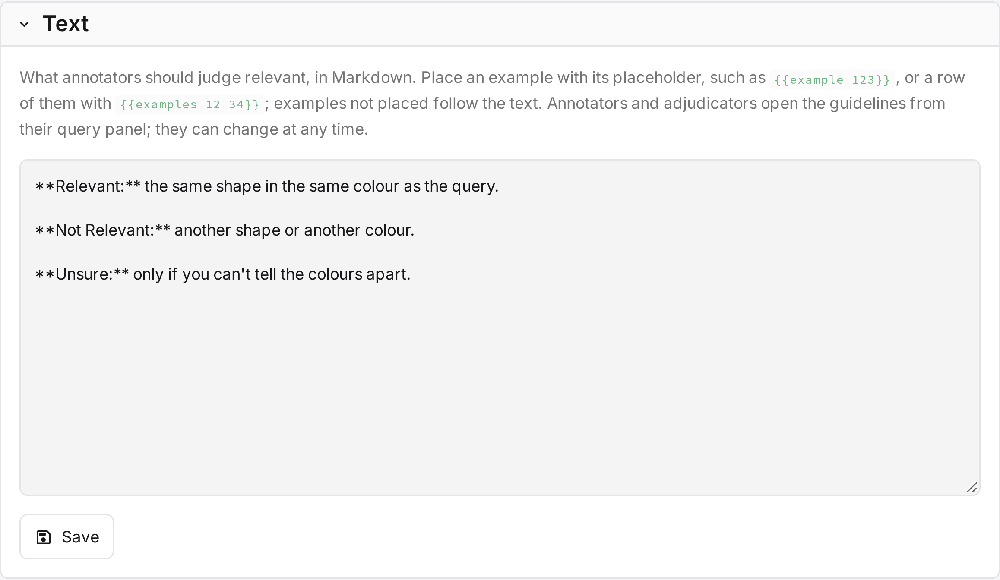
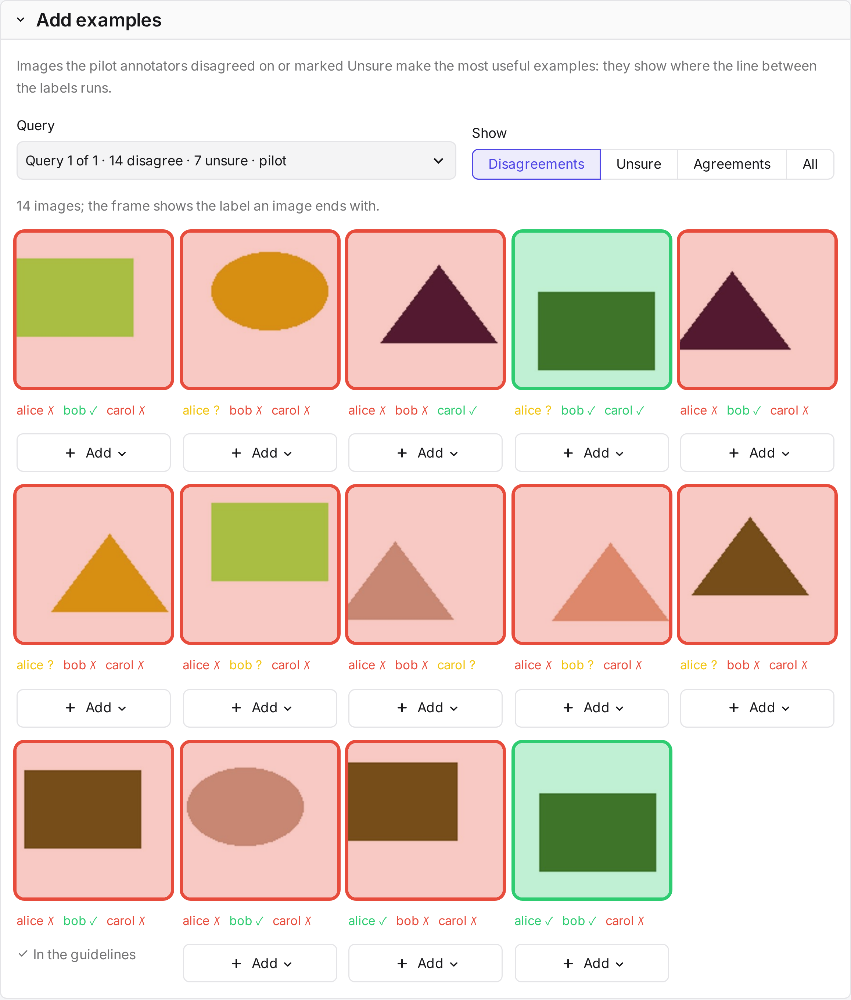

# Guidelines

The **guidelines** tell annotators what counts as relevant. They are Markdown text with example images. Admins
write them in the **Guidelines** tab. Annotators and adjudicators open them from their query panel. The guidelines
can change at any time, and annotators see the new version the next time they open them.

## When to write them

1. **Before the pilot**, write the text: what is relevant, what is not, and what is borderline.
2. **After the pilot**, add examples from the images annotators disagreed on, and sharpen the text where they read
   it differently.

!!! tip "Why examples"
    Detailed written instructions alone are sometimes not enough to raise agreement between annotators
    ([Webber et al. 2012](../reference/references.md)). Examples from real disagreements target the cases where
    people differ.

## The Guidelines tab

| Part | What it does |
|---|---|
| **Text** | The guidelines in Markdown. Placeholders mark where examples appear. |
| **Preview** | The guidelines as annotators see them. Each example shows its id with a copy button. |
| **Add examples** | Judged images to choose from: pick a query, then filter by *Disagreements*, *Unsure*, *Agreements* or *All*. |

| Placeholder | Shows |
|---|---|
| `{{example 123}}` | One example. |
| `{{examples 12 34 56}}` | A row of examples. |

Examples without a placeholder appear at the end, under *More examples*.

## Examples

An example is a judged image, the label it should get, and one sentence on why. It appears next to its query,
framed in the label's colour.

- **Add** under an image creates an example. Its label starts as the image's final or majority label.
- **Why** holds the explanation.
- The bin under an example in the preview removes it.

Examples refer to the study's own images, so nothing is uploaded. Without a judged pilot, the tab offers judged
annotation queries instead.
