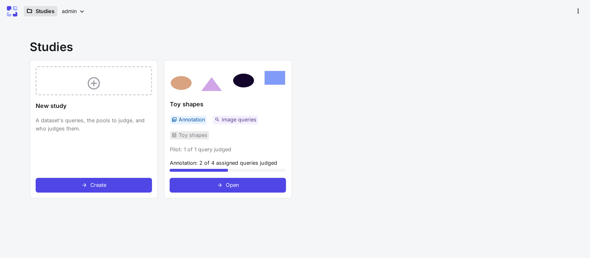
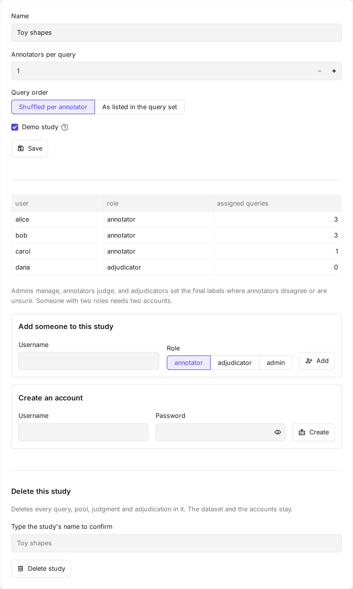

# Run a study

A **study** is one round of judging. It takes the queries of one query set, samples a pool of candidates for each
query, and assigns the queries to annotators. This section follows a study from creation to export, one page per
step.

## The workflow

The Studies page shows one card per study. **New study** creates a study. **Open** on a card shows the study's
tabs, which follow the order of the work. Steps 2 to 4 are optional but recommended.

| Step | Tab | What happens |
|---|---|---|
| 1 · [New study](new-study.md) | | Choose the dataset, queries, candidate sampling, grouping encoder, labels and team. |
| 2 · [Guidelines](guidelines.md) | **Guidelines** | Write what counts as relevant, then add examples from the pilot. |
| 3 · [Pilot](pilot.md) | **Pilot**, **Pilot results** | Annotators judge a few queries image by image. CARA measures their speed and agreement. |
| 4 · [Simulation](simulation.md) | **Simulation** | Compare grouping settings by time and recall. |
| 5 · [Annotation](annotation.md) | **Annotation**, **Progress** | Fix the settings, assign the queries and follow progress. |
| 6 · [Results and exports](results.md) | **Results** | Check agreement, settle disagreements and export qrels. |

**Study settings** in the study's header changes its name and team.

{ width="420" }

## From a dataset to pools

Before the tabs, a study needs its pools. Encoding is only needed for some choices:

1. **Add the dataset** on the command line ([Datasets](../setup/datasets.md)).
2. **Choose how to sample candidates** in [New study](new-study.md#3-candidate-sampling). This decides what must be
   there first:

    | Method | Needs |
    |---|---|
    | **Given candidates** | Candidates listed with each query in the query file. |
    | **Nearest neighbours** | One or more encoders' embeddings of the queries and the collection ([Encoding](../setup/encoding.md)). |
    | **Random sample** | Only the collection. |

3. **Choose the encoder that groups each pool** in [New study](new-study.md#4-grouping). It needs embeddings of the pool's
   images. With given candidates or a random sample, **No encoder** shows every image on its own instead.
4. **Create the study.** CARA samples and groups every pool. Until the first annotation judgment, the **Annotation** tab
   can change the depths or redraw the sample, and regroup.

## Stages

Each card shows the study's stage.

| Stage | When |
|---|---|
| Not started | No pilot queries are chosen yet. |
| Pilot | Pilot queries are chosen. No annotation queries are assigned yet. |
| Annotation | Annotation queries are assigned. |
| Done | Every assigned annotation query is fully judged. |

## Roles

Each person has one role per study. A person who needs two roles needs two accounts.

| Role | Does | Their study card opens |
|---|---|---|
| Admin | Manages the study. Superusers are admins of every study. | the study's tabs |
| Annotator | Judges the queries assigned to them. | the [judge page](../judging/judging.md) |
| Adjudicator | Sets the final labels where annotators disagree or are unsure. Optional; admins can do this too. | the [adjudicate page](../judging/adjudicating.md) |

## Which queries annotators see

Until the pilot starts, annotators see every query. After that, they see only the queries assigned to them: first
their pilot queries, then their annotation queries. The API refuses any other query.
