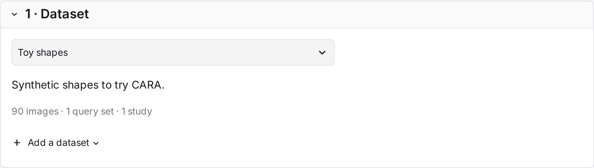
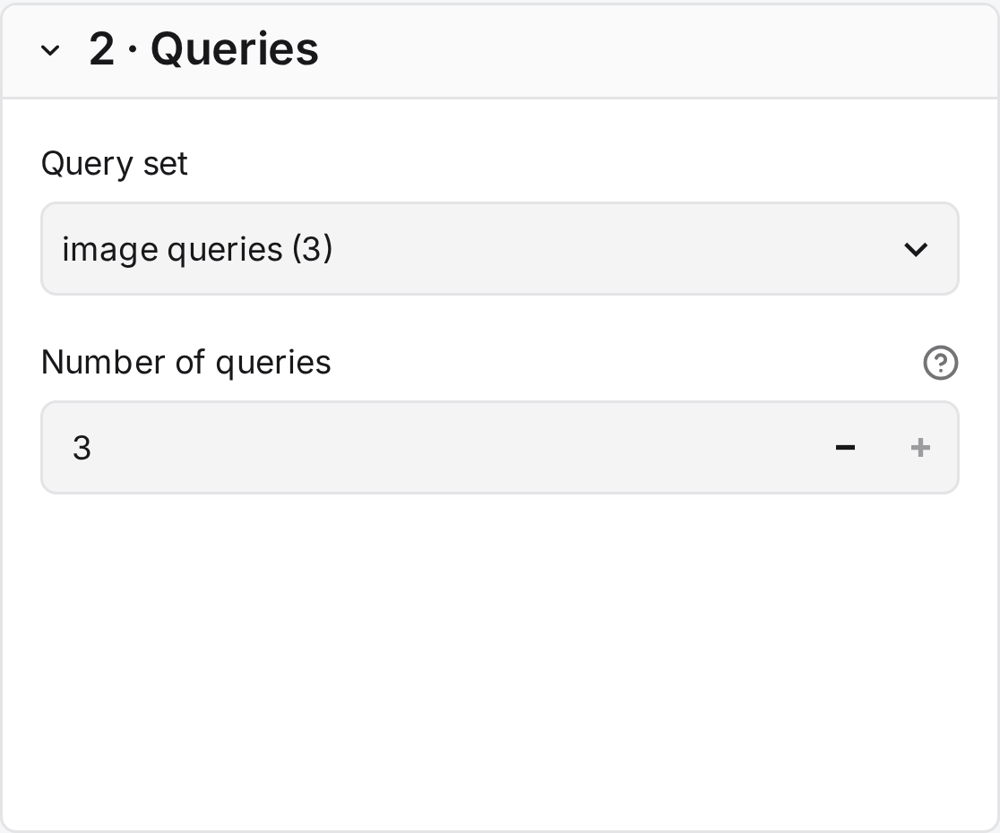
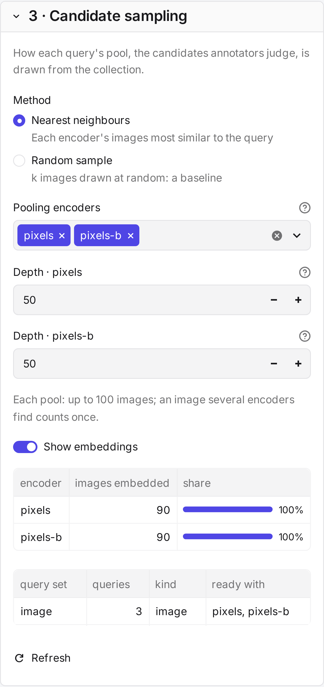
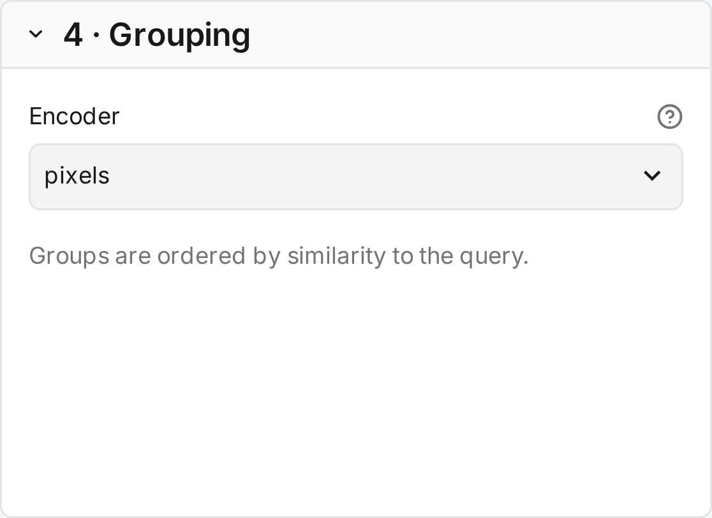
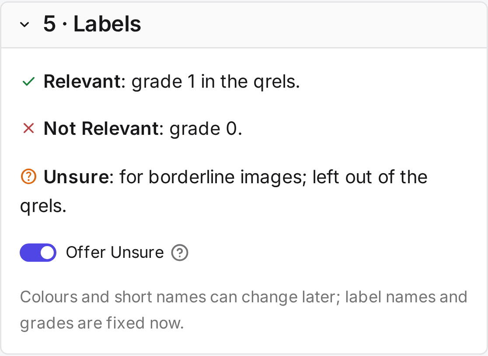
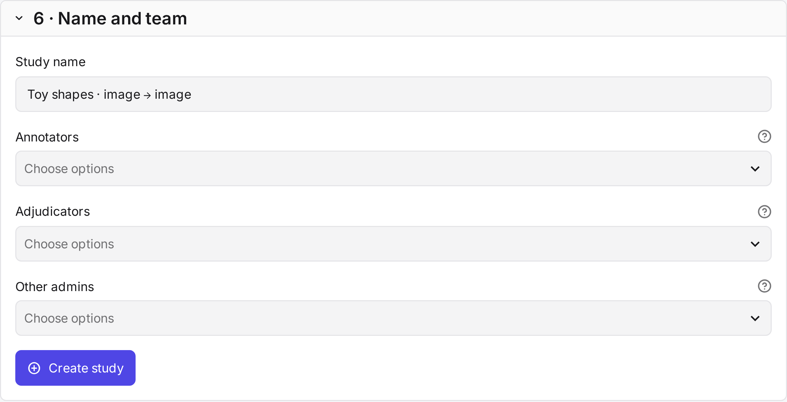

# New study

**New study** on the Studies page creates a study. The page has six sections and a **Create study** button at the
end. Only superusers can create studies.

!!! info "Before you begin"
    Add the dataset ([Datasets](../setup/datasets.md)). To group images, or to sample nearest neighbours, embed it with
    at least one encoder ([Encoding](../setup/encoding.md)).

## 1 · Dataset

The collection the study judges.

| Field | What it does |
|---|---|
| **Dataset** *default: first by name* | The collection to judge. Its description and size appear below. |
| **Add a dataset** | Shows the command that adds a dataset. Datasets are added on the command line only. |

## 2 · Queries

The queries the study judges.

| Field | What it does |
|---|---|
| **Query set** *default: first by name* | The set to judge, shown with its kind and size. |
| **Number of queries** *default: all* | A random sample of the set. Pilot queries are later drawn from this sample. |

## 3 · Candidate sampling

Judging a whole collection for every query is rarely possible, so each query gets a **pool**: the candidates sampled
from the collection for annotators to judge. Encoding is one way to sample them, not the only one.

| Method | Offered when | Use it for |
|---|---|---|
| **Given candidates** | The query file lists candidates. | Judging the pools of existing runs. |
| **Nearest neighbours** | At least one encoder has embedded the queries. | Building pools from the collection with one or more encoders. |
| **Random sample** | Always. | A baseline that no encoder shapes. It finds few relevant images unless relevance is common. |

| Field | What it does |
|---|---|
| **Images per pool (k)** *default: 50* | Random sample only. The number of images drawn per query. |
| **Pooling encoders** *default: the first by name* | Nearest neighbours only. The encoders that add images to each pool. Several encoders keep the pool from favouring one model. |
| **Depth** *default: 50* | One field per pooling encoder: how many of its nearest images it adds. Images found by several encoders count once, as in TREC pooling. |
| **Show embeddings** | Shows how many images each encoder has embedded, which query sets each is ready for, and the `cara encode` command for what is missing. It starts on when embeddings are missing. After running the command ([Where to encode](../setup/encoding.md#where-to-encode)), select **Refresh**. |

CARA has no method yet that samples by metadata or that picks a set representative of the collection. To use such a
sample, list it as given candidates in the query file.

## 4 · Grouping

The encoder that groups each pool, whichever method sampled it.

| Field | What it does |
|---|---|
| **Encoder** *default: first by name* | Groups each pool by visual similarity. **No encoder** shows every image on its own, without groups, Suggest mode or simulation. It is offered with given candidates and random samples. |

## 5 · Labels

The answers annotators can give.

| Field | What it does |
|---|---|
| **Relevant** | Grade 1 in the qrels. |
| **Not Relevant** | Grade 0 in the qrels. |
| **Unsure** | For borderline images. It counts as judged but is left out of the qrels. |
| **Offer Unsure** *default: on* | Whether annotators see Unsure. |

Label names and grades are fixed once the study exists, because judgments refer to them. Colours and short names
can change later.

## 6 · Name and team

| Field | What it does |
|---|---|
| **Study name** *default: dataset · kind → image* | Shown on the study card and above the tabs. |
| **Annotators** *default: none* | The people who judge. |
| **Adjudicators** *default: none* | Optional. The people who set final labels. |
| **Other admins** *default: none* | People who manage the study with you. |

The [roles](index.md#roles) are explained in the overview. New accounts are created under **Study settings** in a
study's header.

## Create study

**Create study** samples the queries, builds every pool and groups it. Large pools can take a minute. **Open the
study** then leads to the **Guidelines** tab, the first step.

The study starts with these settings. You can change them in the **Annotation** tab until the first judgment.

| Setting | Default |
|---|---|
| Grouping | Agglomerative clustering, average linkage, at most 16 images per group. |
| Ungrouped images | Images without a close neighbour in the pool. |
| Group order | Most similar to the query first. |
| Query order | A separate random order for each annotator. |
| Review round | On, not required. |
| Suggest mode | Off. |
| Annotators per query | 1 |

The [Simulation](simulation.md) compares other groupings. [Study settings](../reference/settings.md) lists every
setting.
