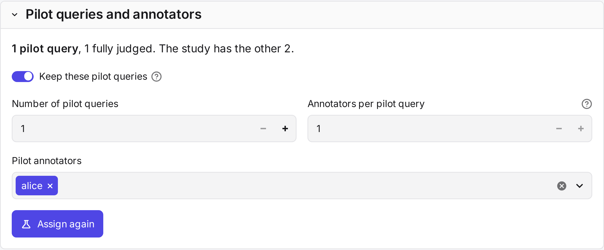
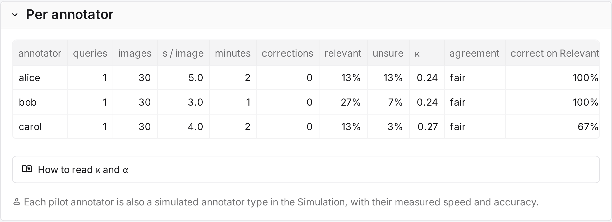

# Pilot

A **pilot** is a small set of queries that annotators judge before the grouping is fixed. Pilot images are shown
one by one, without groups. The pilot shows how your annotators judge. Its disagreements become examples for the
[guidelines](guidelines.md), and its labels are the ground truth for the [simulation](simulation.md).

!!! info "Before you begin"
    The study has annotators. To measure agreement, at least two annotators must judge the same pilot queries.

## Pilot queries and annotators

| Field | What it does |
|---|---|
| **Number of pilot queries** *default: 5* | How many queries to draw at random. |
| **Annotators per pilot query** *default: 2* | How many annotators judge each pilot query. Two or more measure agreement. |
| **Pilot annotators** *default: all* | Who judges the pilot. Queries are spread over them in turn. |
| **Keep these pilot queries** | Turn off to draw new queries. Not possible after the first pilot judgment. |
| **Start the pilot** | Assigns the pilot queries. Later, **Assign again** changes the assignments. |

**Pilot progress** below shows how far each annotator is. Pilot judgments lock no settings.

## Pilot results

The **Pilot results** tab shows Krippendorff's α over the pilot and one row per annotator.

| Column | How it is computed |
|---|---|
| **s / image** | Median time per image labelled on its own. Pauses over 10 minutes are left out. |
| **minutes** | Total time between actions, without pauses over 10 minutes. |
| **corrections** | Actions that changed a label the annotator had given before. |
| **relevant**, **unsure** | Share of the annotator's labels that are relevant, and that are Unsure. |
| **κ**, **agreement** | Mean Cohen's κ with each other annotator, on images both labelled, and how to read it. |
| **correct on Relevant**, **correct on Not Relevant** | Agreement with the majority of the other annotators, on relevant and on not relevant images. |

The simulation uses these figures to model each pilot annotator.

!!! tip
    Look at the disagreements before the figures. The **Guidelines** tab lists them, and they make the best
    examples.
