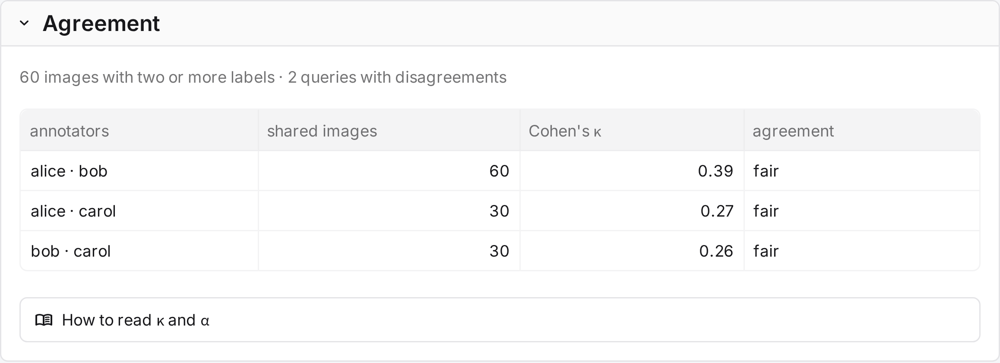
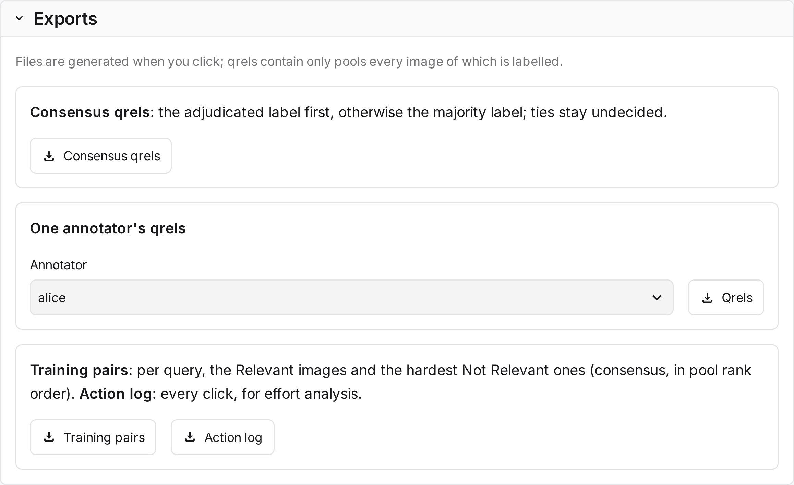

# Results and exports

The **Results** tab shows the study's outcome: queries judged, judgments, time spent, agreement, and the share of
each label. It also settles disagreements and exports the labels.

!!! info "Before you begin"
    Agreement needs two or more annotators per query (**Annotators per query** in
    [Annotation](annotation.md#start-annotation)).

## Agreement

| Measure | Computed over |
|---|---|
| **Cohen's κ** | Each pair of annotators, on the images both labelled. |
| **Krippendorff's α** (nominal) | All annotators, on the images labelled at least twice. |

A measure is hidden when it is undefined, for example when all labels are the same. The α card turns green from
0.80. **How to read κ and α** shows these scales:

| κ ([Landis and Koch 1977](../reference/references.md)) | Reading |
|---|---|
| 0.81–1.00 | almost perfect |
| 0.61–0.80 | substantial |
| 0.41–0.60 | moderate |
| 0.21–0.40 | fair |
| 0.00–0.20 | slight |
| below 0 | poor |

| α ([Krippendorff 2004](../reference/references.md)) | Reading |
|---|---|
| 0.80 and above | reliable |
| 0.667–0.80 | tentative conclusions only |
| below 0.667 | unreliable |

## Final labels

Where annotators disagree or chose Unsure, a final label decides what the consensus qrels say. Admins set final
labels here. [Adjudicators](../judging/adjudicating.md) set them on their own page, which works the same way.

## Exports

| Export | Holds |
|---|---|
| **Consensus qrels** | The final label where one is set, otherwise the majority label. |
| **One annotator's qrels** | That annotator's labels. |
| **Training pairs** | Per query, the relevant images and the hard negatives. |
| **Action log** | Every action as JSON lines, for effort analysis. |

Qrels are TREC lines, `query 0 doc grade`. They contain only fully judged queries, so an unjudged image is never
read as not relevant. Unsure labels are left out. In the consensus qrels, a tie counts as unlabelled, so its query
is left out until the tie is settled.

Training pairs are JSON lines with `query_id`, `positives` and `hard_negatives`. Positives have a consensus grade
of 1 or more, and negatives a grade of 0. Negatives keep the pool's rank order, so the first ones are the
look-alikes the retrieval system ranked highest.
