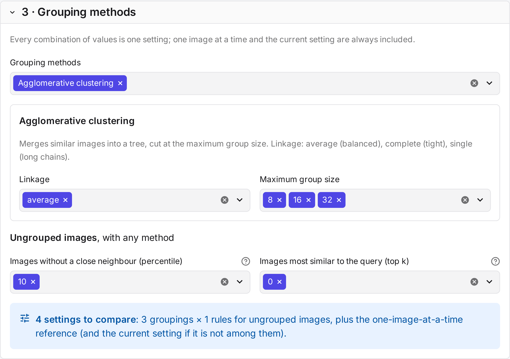
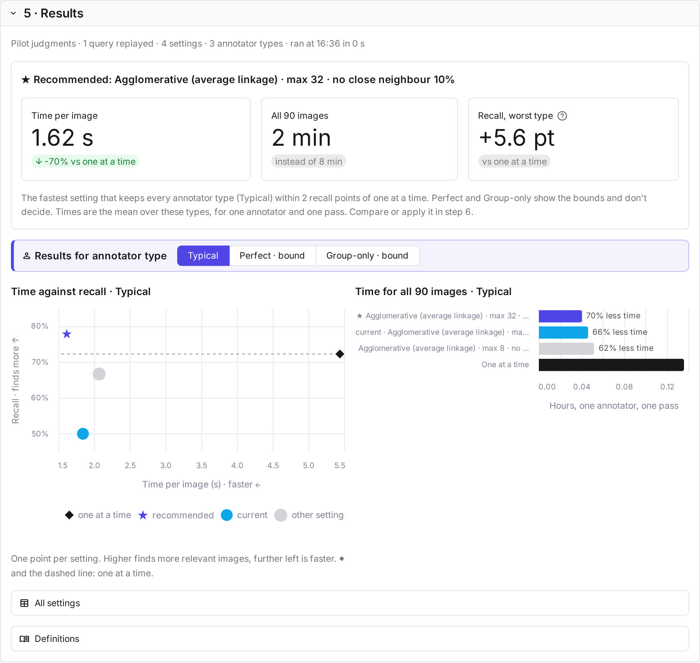
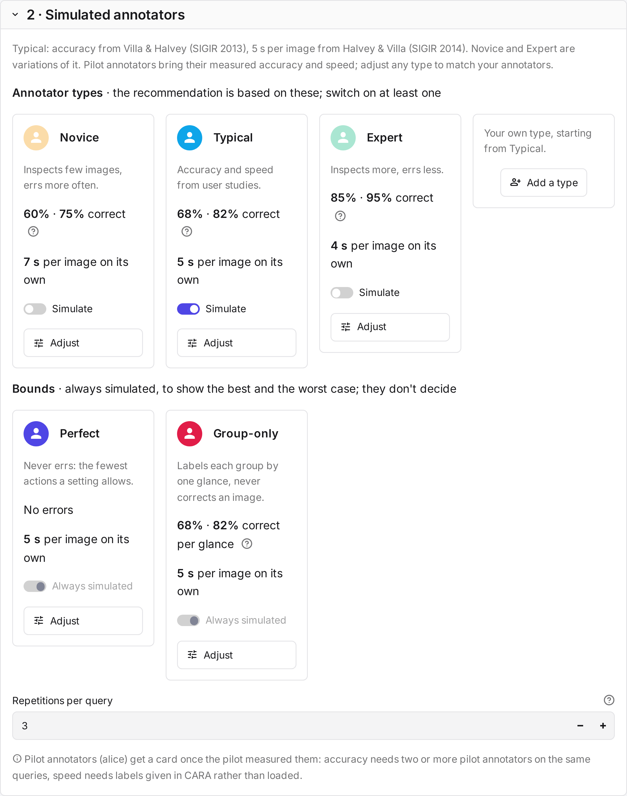

# Simulation

The **settings simulator** answers one question before annotation starts: which grouping saves the most time
without losing relevant images? Simulated annotators judge a sample of the study's queries under each grouping
setting. The results show the time each setting takes and the recall it reaches.

!!! info "Before you begin"
    The study has an encoder. It also needs labels to compare against: a judged [pilot](pilot.md), or a qrels file
    in the dataset's `qrels/` folder.

## The steps

| Step | What you do |
|---|---|
| 1 · **Ground truth** | Choose the labels to compare against: the pilot annotators' majority, or a qrels file. |
| 2 · **Simulated annotators** | Choose the annotator types the recommendation is based on: Novice, Typical, Expert, one type per pilot annotator, or your own. With a pilot, its annotators are on by default; without one, Typical is. Perfect and Group-only are always simulated as bounds. |
| 3 · **Grouping methods** | Choose the methods and the parameter values to try. Each combination is one setting. Judging image by image and the study's current setting are always included. |
| 4 · **Summary** | Check what will run and how many queries to replay, then select **Run the simulation**. |
| 5 · **Results** | See the recommended setting and what it saves, then compare time and recall per setting, for each annotator type. |
| 6 · **Choose a setting** | Compare one setting with judging image by image, for every annotator type. **Use this setting** proposes it on the **Annotation** tab, where **Save and regroup every pool** applies it. |

### The recommendation

CARA recommends one setting for the study (★): the fastest setting that keeps every annotator type you chose
within 2 recall points of judging one image at a time. Each type is compared with its own recall when judging
one at a time, and speed is the mean over these types.

Perfect and Group-only don't count. Perfect never errs, and Group-only labels each group after one glance and
never corrects an image, so they show the best and the worst case of each setting rather than how people judge.
If every grouping setting loses more than 2 points for some type, CARA recommends judging one image at a time.

In the charts, one at a time is the diamond and the dashed line, and the bar chart shows how much less time each
setting takes than it. In step 6, the table shows the chosen setting for every annotator type, with a ✓ where
recall stays within 2 points. The recommendation is a suggestion: you choose the setting.

## Simulated annotators

A simulated annotator works through each query as a person would on the judge page:

1. It labels the ungrouped images one by one.
2. For each group, it looks at some of the images and labels the group, in one action, with the label most of them
   appear to have. It then corrects the images it looked at and perceives differently.
3. In the review round, it changes the labels it perceives differently.

Only the images it looks at cost time, and only they can be corrected.

The types differ in what they see and what they correct.

| Type | Looks at in a group | Labels the group | Corrects |
|---|---|---|---|
| Perfect | every image | with its true majority label | every wrong image |
| Group-only | the one image most similar to the query | with the label that image appears to have, with errors at its accuracy | nothing |
| Novice, Typical, Expert, pilot types | every image of a small group, some of a larger one | with the label most of the images it looked at appear to have, with errors at its accuracy | the images it looked at and perceives differently |

Novice, Typical, Expert and pilot types look at every image in a small group. In a larger group, they look at each
image only with some probability, because people skip rows in image grids ([Xie et al. 2019](../reference/references.md)).
Because these types and Group-only decide at random, each query is replayed for them three times by default
(*Repetitions per query*), and the results are averaged.

| Value | Novice | Typical | Expert |
|---|---|---|---|
| Accuracy on relevant images | 0.60 | 0.68 | 0.85 |
| Accuracy on not relevant images | 0.75 | 0.82 | 0.95 |
| Largest group checked image by image | 6 | 8 | 16 |
| Probability of checking an image in a larger group | 0.5 | 0.7 | 0.9 |

Typical's accuracies come from a relevance study ([Villa and Halvey 2013](../reference/references.md)). Novice and Expert are illustrative
variations. A pilot type uses Typical's values with the pilot annotator's measured accuracy and speed.

## Time and recall

Time is the sum of the annotator's actions and glances, each with a fixed cost:

| Action | Typical | Source |
|---|---|---|
| Judge one image | 5 s | Halvey and Villa 2014 |
| Label a group | 3 s | assumed |
| Correct one image | 1 s | assumed |
| Split a group | 1 s | assumed |
| Glance at a relevant image | 1.4 s | Yan et al. 2008 |
| Glance at a not relevant image | 0.2 s | Yan et al. 2008 |

You can change every value on the annotator type's card.

**Recall** is the share of truly relevant images that end up labelled relevant. Perfect shows the fewest actions a
setting allows. Group-only shows what an annotator who labels each group after one glance and never corrects would
miss. The sources are listed under [References](../reference/references.md).
